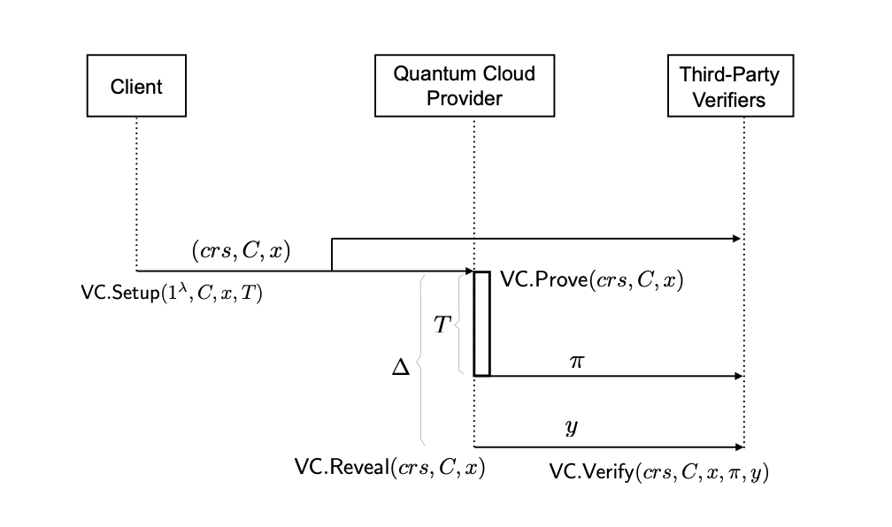
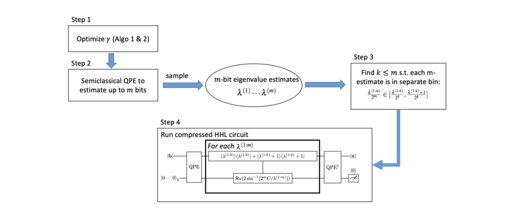
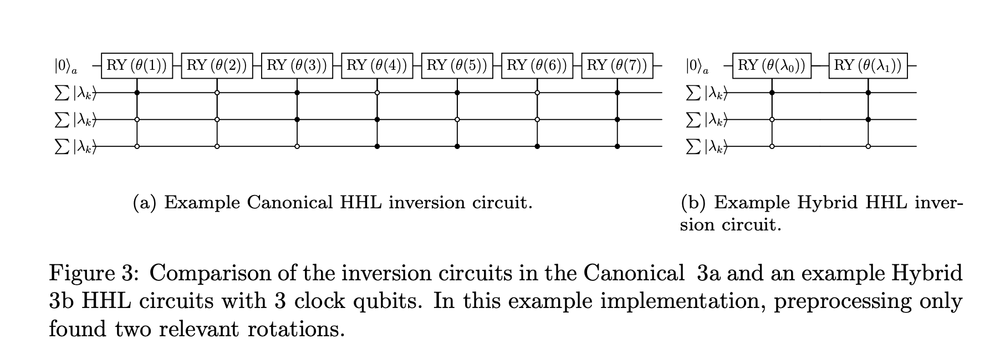

# Quantum Verification Artifact

This artifact accompanies the paper and contains three self-contained experiments that together demonstrate the security argument: solving a linear system with the Enhanced Hybrid HHL algorithm is faster or equal to solving the time-lock puzzle protecting the verification key.

## What the experiments do

**Experiment 1 — Enhanced Hybrid HHL**

Solves a small linear system `Ax = b` on a local Qiskit simulator and reports the solution, L2 error against the classical result, circuit depth, and total runtime. This establishes that the algorithm works correctly before scaling it up.

**Experiment 2 — Time-Lock Puzzle (TLP) benchmark**

Runs the three TLP phases (garbling setup, puzzle generation, puzzle solving and verification) across a range of T values and records timing for each. The key result here is that PSolve time scales linearly with T. This linearity is what makes the projection in Experiment 3 valid: you can measure PSolve at small T values and extrapolate to any large T with confidence.

**Experiment 3 — Scaling comparison**

Sweeps matrix size N, runs Enhanced HHL on several random N×N matrices per size, and compares the average HHL runtime against projected TLP PSolve time at a chosen T (either by actually running the TLP experiment or by extrapolating the value from the linear relationship). The claim being tested is that HHL finishes before the puzzle can be solved.

## Installation

Requires Python 3.10 or later. Using `uv` (recommended):

```
uv sync
```

Or with pip:

```
pip install -r requirements.txt
```

## Running the experiments (if using uv or just python3 script-name --cli-arg)

```
uv run run_experiments.py                  # all three experiments
uv run run_experiments.py --hhl-only       # Experiment 1 only
uv run run_experiments.py --tlp-only       # Experiment 2 only
uv run run_experiments.py --scaling-only   # Experiment 3 only
```

By default, Experiment 3 uses a linear projection for TLP time rather than actually running the puzzle at large T (which can take a long time). To run the full puzzle instead:

```
uv run run_experiments.py --scaling-only --tlp-actual
```

All configurable parameters (matrix, T range, N values, number of matrices, clock qubits) are in the `INPUTS` section at the top of `run_experiments.py`.

## Output

Each experiment saves a plot to `visualization/outputs/` and a JSON file to the working directory:

- `hhl_results.png`
- `tlp_benchmark_plot.png` and `tlp_benchmark_results.json`
- `scaling_results.png` and `scaling_results.json`

## Garbling modes (CRGC vs PRGC)

The TLP supports two garbling modes, selectable via the `garbling_mode` argument in [tlp_garbling4.py](timelock_puzzle/tlp_garbling4.py): `"crgc"` (paper baseline) and `"prgc"` (input-private variant). In **CRGC** mode, every gate truth table is XOR-flipped once by [`get_flipped_circuit`](crgc_garbled_circuits/circuit_flipper.py) and reused across puzzles; InputB travels in plaintext and the public mask leaks some Generator-input information to a single-player adversary (CRGC §2.2). In **PRGC** mode ([prgc_partition.py](timelock_puzzle/prgc_partition.py)), gates are partitioned into *reusable* (CRGC-style, XOR-flipped once at setup) and *non-reusable* (every gate downstream of an InputB wire `m`/`z` or of a leaked InputA wire, plus the final output gates). The non-reusable gates are Yao-garbled **fresh per puzzle**: PGen samples new per-wire key pairs and new encrypted truth tables for every puzzle and ships them inside the puzzle encoding, so no key material is ever reused across puzzles. Every Yao key carries a point-and-permute select bit, so the solver picks table rows and decodes outputs without any access to the generator's secret `pk`.

The solver-side walker (`_evaluate_prgc`) runs in two passes. Pass 1 evaluates the reusable (sequential) section on wire-level bits. Where a reusable gate's output feeds a non-reusable gate (a boundary wire — this includes the chain output `f^T(x)`), PGen delivers the matching Yao key **sealed**: each boundary key is encrypted under `K_unlock = SHA256(packed boundary-wire values)`, which the solver can only derive after pass 1 has computed the chain output. Pass 2 opens the seal and Yao-decrypts the non-reusable gates. This is the non-interactive analogue of the OT at section inputs in CRGC §2.5 — OT forces the evaluator to know the wire value before receiving the key; the seal forces the solver to *compute* it. Per-puzzle PGen cost stays small while the reusable section is garbled only once.


## Choosing T for your machine

The T values in `N_TO_T` inside `run_experiments.py` are not universal — they are calibrated for specific hardware. PSolve time is proportional to T (the puzzle solver performs T sequential calculations), so the right T for your machine is whichever value makes PSolve time just exceed HHL time.

To calibrate: run Experiment 2 to measure PSolve time per unit T on your hardware, then divide your HHL time (from Experiment 1 or 3) by that rate. The `--scaling-only` mode does this calibration automatically at small T and extrapolates, which is why the projected TLP time printed by Experiment 3 will differ from what the paper reports.

## Some considerations

**Different hardware.** The absolute timing numbers (HHL seconds, TLP seconds) are machine-dependent. The relationship between them is what matters, not the absolute values.

**Different simulator.** The paper ran circuits on AWS Braket. This artifact uses Qiskit AerSimulator locally. Aer and Braket decompose gates differently, so circuit depths will not match exactly even for identical circuits. The depth ordering across N values is preserved. More specifically, we used the SV1 braket simulator to run the experiments.

**Sign ambiguity in the HHL solution.** The Enhanced Hybrid HHL implementation measures solution components by projecting onto computational basis states and recording probabilities. Probabilities are always non-negative, so the sign of each component is lost. Fidelity is computed using amplitude magnitudes only (`sqrt(|probability|)` vs `|classical_solution|`), which is why a perfect HHL solution can still show a small apparent discrepancy when compared component-by-component against the classical result.

**Why Enhanced HHL rather than standard HHL.** Standard HHL assumes exact eigenvalue estimation, which requires exponentially many clock qubits in practice and produces circuits too deep to simulate reliably. The Enhanced Hybrid variant uses classical preprocessing to estimate eigenvalues efficiently, then feeds them into a hardware-friendly eigenvalue inversion circuit. This reduces circuit depth to a practical range while preserving the correctness guarantees and quantumness. This is to allow us to use it as a proof of concept for when/if HHL becomes fully mature.

## Enhanced Hybrid HHL

The HHL algorithm solves a linear system Ax = b by encoding the solution in a quantum state. It works in three stages: eigenvalue estimation (QPE), eigenvalue inversion (controlled rotations), and readout. The Enhanced Hybrid variant improves on standard HHL by separating the eigenvalue estimation from the quantum circuit — classical or hybrid preprocessing computes the eigenvalues first, and only the inversion step runs on the quantum hardware.

### Preprocessing options

Preprocessing determines how eigenvalues of A are estimated before the inversion circuit is built. Four options are available in the codebase:

- **ideal** — computes eigenvalues classically using numpy. Exact and fast; used in the experiments as it gives an upper bound on what the algorithm can achieve.
- **Yalovetzky (QCL-QPE)** — quantum-based estimation using a compact iterative QPE circuit from [NISQ-HHL](https://arxiv.org/abs/2110.15958). Requires fewer qubits than canonical QPE but is noisier.

- **Lee (standard QPE)** — canonical phase estimation circuit. More accurate than Yalovetzky but uses more qubits.
- **Iterative QPE** — a bit-by-bit phase estimation that requires only one qubit per round. Lower qubit overhead but more circuit repetitions.

The experiments use ideal preprocessing (`make_preprocessor` in `preprocessing.py` wraps the ideal path by default).

### Inversion circuit options



Once eigenvalues are known, the inversion stage applies controlled-RY rotations to encode 1/λ in the ancilla qubit amplitude. Four inversion circuits are available:

- **EnhancedHybridInversion** — used in the experiments. Applies a "enhancement" correction, which adjusts rotation angles to account for the finite precision of QPE encoding. This reduces the error introduced when eigenvalues do not fall exactly on a clock register bitstring.
- **HybridInversion** — the base hybrid inversion without the enhancement correction. Simpler but less accurate when clock qubits are limited. It's advantage is that it only has rotations for values that are above a certain relevance threshold, so it does not compute all values.
- **CanonicalInversion** — applies a controlled-RY for every possible bitstring in the clock register. Circuit depth grows exponentially with clock qubits; impractical beyond ~6 qubits.
- **GrayCodeInversion** — uses Qiskit's `ExactReciprocal` gate, which encodes 1/x exactly using a Gray-code decomposition. Efficient in gate count but assumes the eigenvalues are uniformly distributed across the clock register.

### Key parameters

**`num_clock_qubits`** — controls QPE precision. More clock qubits means finer eigenvalue resolution and deeper circuits. The experiments use 7 qubits (`SCALING_NUM_CLOCK_QUBITS`), which balances depth against accuracy on the local simulator. The paper used a similar value; changing this will shift both circuit depth and fidelity.

**`max_eigenvalue`** — sets the scaling of the Hamiltonian simulation so the largest eigenvalue maps to the highest representable clock register value. In the experiments this is estimated as `1.2 × max(|eigvals(A)|)`, giving a 20% margin to avoid overflow.

**`optimization_level`** — passed to Qiskit's `transpile`. Set to 0 throughout to disable gate merging and cancellation, so reported circuit depths reflect the actual logical structure rather than an optimised version. Using a higher level would reduce depth but make the numbers harder to interpret or reproduce.## Project structure

```
run_experiments.py     entry point and INPUTS configuration
enhanced_hybrid_hhl/   Enhanced Hybrid HHL implementation
timelock_puzzle/       time-lock puzzle (garbling, generation, solving)
visualization/         plotting code; outputs saved to visualization/outputs/
circuits/              auxiliary circuit definitions (Sha256 in bristol format)
crgc_garbled_circuits/  Components for circuit garbling used in TLP. 
```


## Acknowledgement 

- The Enhanced Hybrid HHL used in this paper is largely the code from:
 https://github.com/jackhmorgan/Enhanced-Hybrid-HHL (few minor fixes from our end)
- The Completely Reusable Garbled Circuits:
 https://github.com/chart21/CRGC