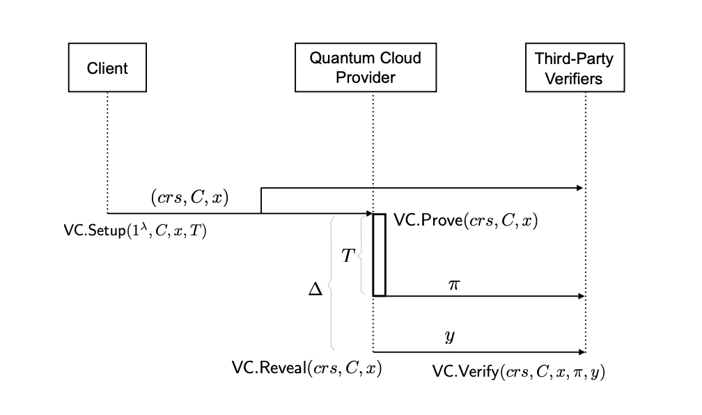
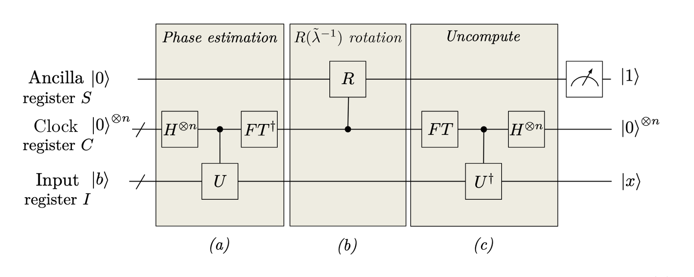

# Publicly Verifiable Classical Verification of Quantum Computation with Time Locked Puzzles



A Publicly verifiable Classical Verification of Quantum Computation Scheme utilizing Time Locked puzzles to prove the correctnesss of the quantum computation using a non-quantum verifier.

It uses a garbled circuit of $\mu$ repetitions of a sequential function (in our case SHA-256 which is considered Post-Quantum Secure), which must be computed $\mu$ times by the prover such that the time it takes to solve the puzzle and recover the puzzle secret is strictly greater than the time it takes to run the Quantum Circuit. 

_NOTE:_ This repo refers to the repititions parameter as T, however in later material we refer to it as $\mu$.

We chose the __Harrow-Hassidim-Lloyd (HHL)__ algorithm which solves systems of linear equations for a given matrix $A∈ℂ^{𝑁×𝑁}$ and input vector $𝑥∈ℂ^{𝑁}$, as an example of this protocol (More specifically we used a Hybrid version called _Enhanced Hybrid HHL_ to deal with constraints of current Quantum architecture).




## Experimental Specifications
### HHL 
- We Used AWS Braket's SV1 Quantum Simulator to run the simulation using the t3.medium computer. Scripts related to running and retrieving Quantum results are AWS-specific, but could be modified to run on any Quantum hardware.


##### Results:
- enhanced_hybrid_hhl/experiments/aws_braket

### Relationship between TLP - Time and Quantum Circuit - Time
- We generalized the experiment to test the strong relationship between the Time locked puzzle to time and Any quantum circuit to time (not necessarily HHL). 

The experiment used a multitude of randomly generated circuits of 5,10,15,20 qubits and a range of circuit depths to test the affect on execution time and a number of randomly generated puzzles for T 1 to 30

##### Code:
- benchmark_tlp_random.py
- benchmark_qiskit_random.py

##### Results: 
- benchmark_results_qiskit_random
- benchmark_results_T1_30

## Project Structure
* circuits/ - Contains the SHA256 circuit in Bristol Fashion
* crgc_garbled_circuits/ - All relevant modules and functions for circuit garbling (python port of the CRGC C++ implementation)
* crgc_garbled_circuits/scripts/ - Contains the Generation and Evaluation scripts for circuit garbling
* enhanced_hybrid_hhl/ - All the relevant modules and functions for constructing the HHL circuit with different construction options (Full Quantum/Hybrid, types of hybrid components)
* enhanced_hybrid_hhl/braket_projection.py - The functions to submit the generated HHL circuit to the AWS server and retrieve the quantum job results and calculate the results.
* cvqc_protocol/ (IN PROGRESS) - Full PV-CVQC scheme with Mahadev protocol
* test_scripts/ - Example scripts for running the Circuit Garbling and Execution of the SHA-256 Sequential Circuit.
* timelock_puzzle/tlp_garbling.py - The full implementation of the CRGC Garbled Circuit on a Sequential SHA-256 circuit
* timelock_puzzle/sequential_functions.py - Contains the SHA-256 circuit loader and circuit constructor to take in inputs and be used by the tlp_circuit_builder circuit
* time_lock_puzzle/tlp_circuit_builder.py - constructs the unrolled TLP circuit


## Running the components

### CRGC


```bash
# Generate CRGC from the circuit called sha256 found in the circuits directory 
python3 generator.py --circuit sha256 --inputa 42 --inputb 17 --store txt

# Evaluate CRGC
python3 evaluator.py --circuit sha256 --inputb 17 --store txt
```


### TLP with Garbling 

```python
import secrets
from timelock_puzzle.tlp_garbling import PythonGarbledTLP
from crgc_garbled_circuits.circuit_writer import export_circuit_separate_files, export_obfuscated_input

# Set T to be the number of iterations for the SHA256 circuit
tlp = PythonGarbledTLP(lam=256, T=T, use_sha256=True)

pp = tlp.PSetup_Garble()

secret = secrets.randbelow(2)
puzzle_Z = tlp.PGen(secret, pp)

recovered = tlp.PSolve(puzzle_Z, pp)

print(secret == recovered) # True if correct, False if not

```


### HHL 

- An example of the problem set, submission results and retrieval results can be found in enhanced_hybrid_hhl/experiments
    - The Retrieval files are the same as the submission but with an added _retrieval.json added to the end.

- _Note_: For the AWS simulation you must first use the AWS CLI to authenticate and generate the necessary keys/Ids to run the simulation. (Refer to: https://docs.aws.amazon.com/cli/v1/userguide/cli-configure-files.html)


#### AWS 
```python
import os
import json
import numpy as np
from enhanced_hybrid_hhl import (
    QuantumLinearSystemProblem,
    run_braket_projection_submission,
    run_braket_projection_retrieval
)

# Setup
script_dir = os.path.dirname(os.path.realpath(__file__))

# Load problems from JSON
problem_file = os.path.join(script_dir, "custom_4x4_problem2.json")
with open(problem_file, 'r') as f:
    json_data = json.load(f)

# Convert to QuantumLinearSystemProblem objects
problem_list = []
for p in json_data['problem_list']:
    A_matrix = np.array(p['A_matrix'])
    b_vector = np.array(p['b_vector']).flatten()
    problem_list.append(QuantumLinearSystemProblem(A_matrix, b_vector))

print("="*60)
print("Example: Braket Projection Submission and Retrieval")
print("="*60 + "\n")

# ========== SUBMISSION ==========
print("STEP 1: Submitting projection measurements to AWS Braket\n")

result_file_path = run_braket_projection_submission(
    problem_list=problem_list,
    output_dir=script_dir,
    aws_region="eu-west-2",
    device_arn="SV1",
    k_qubits=10,
    shots=3000,
    preprocessing_mode="ideal",  # or "yalovetzky"
    projection_mode="all_components",  # or "subset"
    # projection_subset=[0, 1, 2],  # if using subset mode
    probability_threshold=0,
    max_eigenvalue=10,
    optimization_level=1
)

print(f"\nSubmission complete! Results saved to:\n  {result_file_path}\n")

# ========== RETRIEVAL ==========
print("\n" + "="*60)
print("STEP 2: Retrieving results from AWS Braket")
print("="*60 + "\n")

# You can retrieve immediately or later by providing the file path
retrieval_file_path = run_braket_projection_retrieval(
    result_file_path=result_file_path,
    aws_region="eu-west-2",
    device_arn="SV1",
    output_suffix="_retrieval"
)


```
#### Local Simulator
(found in hhl_example.py)


### References
Our work utilizes the Reusable Garbling Circuits and Enhanced Hybrid HHL from these repos:
- CRGC
    - repo: https://github.com/chart21/CRGC.git
    - paper:https://www.scitepress.org/PublishedPapers/2022/111453/111453.pdf
- Enhanced Hybrid HHL:
    - repo: https://github.com/Greenstan/Enhanced-Hybrid-HHL.git
    - paper: https://arxiv.org/abs/2404.10103