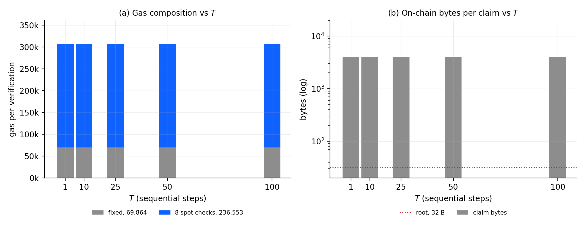
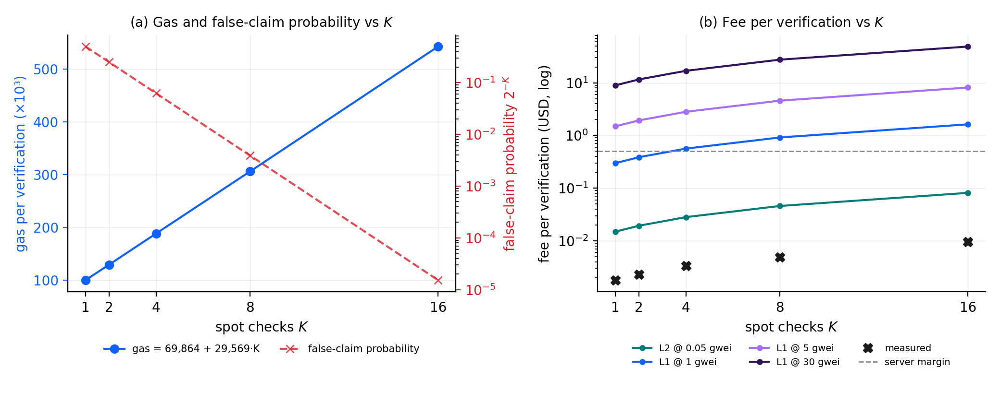
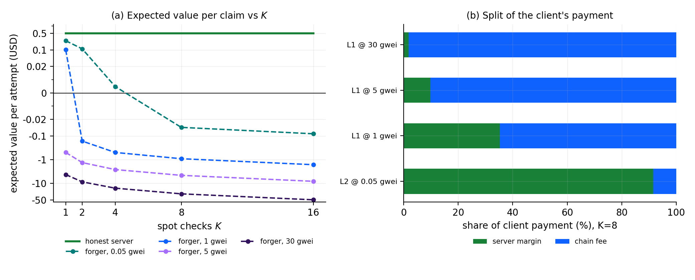
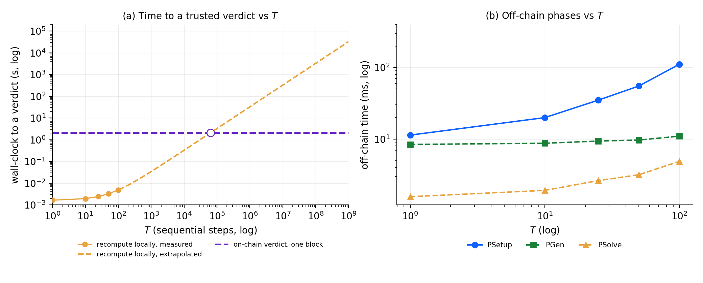

# Figures

Captions and interpretation for the figures in [`bench/figures/`](../bench/figures).
The images themselves carry data only — axis labels, tick labels and legends.
Everything explanatory lives here.

## Scope

All figures are a **proof of concept**. Current quantum algorithms are
theoretically better than their classical counterparts but are still executed
on small, error-prone toy circuits, so the protocol is benchmarked at
640-gate garbled circuits with `T ≤ 100`. That is enough to exercise every
mechanism end to end — garble, seal, time-lock solve, claim, on-chain verdict,
escrow and payout — but it is **not** a production scale claim. Where a figure
extends beyond the measured range it is drawn dashed and is labelled as an
extrapolation.

Every number comes from measured runs against the escrow contract on Base
Sepolia (the latest sessions in
[`bench/evm_results.json`](../bench/evm_results.json): per-transaction gas, fee
and latency) and [`bench/commerce_ledger.json`](../bench/commerce_ledger.json)
(escrow cycles, balances, profit). Claim sizes in Figure 1b are
replayed from the real TLP rather than modelled. Fees are quoted at
ETH = $3,000.

Per-spot-check cost is ~29.6 k gas and the fixed cost ~69.9 k gas, so the
`K = 8` configuration used throughout costs ~306 k gas to verify.

---

## Figure 1 — `fig1_flat_in_T.png`



**(a) Gas composition vs T.** Verification gas at `K = 8` for
`T ∈ {1, 10, 25, 50, 100}`, split into the part that does not depend on `T`
(grey: operations, Merkle paths, Goldreich–Levin; blue: the eight Yao
spot-checks). Both segments are constant by construction and confirmed constant
by measurement: the `K`-linear model `gas = 69,864 + 29,569·K` predicts the
measured totals within 0.1 % at every `T`, so no third segment is drawn — the
former T-dependent term (the non-reusable-gate bitmap header) was removed from
the wire format: the puzzle tree contains a leaf only for non-reusable gates,
so the gate-leaf Merkle proof is the membership proof.

**(b) On-chain bytes per claim vs T.** The claim is a constant 3,980 B at
every `T`; `max_gate` still moves with `T` (895 → 13,567) but lives inside
fixed-width fields. The registered commitment stays 32 B. The puzzle
body — 641 Merkle leaves, ~44 kB of gate tables — never reaches the chain.
Nothing in the claim moves with `T`: the nine Merkle paths (3,006 B), the eight
spot-check tables (512 B) and the remaining fields (462 B) are byte-identical at
every `T`.

**Reading.** Both the verification *logic* and the claim *bytes* are constant
in `T`: bigger `T` means more off-chain solver work (PSolve grows linearly),
never a bigger on-chain check. There is no claim-size cap to worry about — the
former 4,096-byte bitmap limit is gone with the bitmap itself.

---

## Figure 2 — `fig2_linear_in_K.png`



**(a) Gas and false-claim probability vs K.** Gas for
`K ∈ {1, 2, 4, 8, 16}` at `T = 1` (left axis), against the probability `2^-K`
that a false claim survives all spot-checks (right axis). Gas is linear:
99,658 → 543,156, i.e. +29,570 per check.

**(b) Fee per verification vs K.** The same measured gas priced at four base
fees: an L2 at 0.05 gwei (Base/Arbitrum), and L1 at 1, 5 and 30 gwei. Black
crosses are the fees actually paid during the Base Sepolia sweeps (base fee
~0.004 gwei, so they sit on the L2 curve); the dashed line is the $0.50 server
margin used in the commerce experiment.

**Reading.** `K` is the security dial and it is cheap in gas terms: sixteen
spot-checks cost 1.8× eight (5.5× one), and in absolute terms the fee is
dominated by the venue, not by `K`. At `K = 8` the fee is $0.05 on an L2, $0.92 at 1 gwei,
$4.59 at 5 gwei and $27.55 at 30 gwei. The margin line matters: above it the chain costs
more per claim than the server earns, which happens at `K ≥ 8` on L1 at 5 gwei.

---

## Figure 3 — `fig3_payoff.png`



**(a) Expected value per claim vs K.** The honest server's payoff (it keeps the
$0.50 margin) against a forger's per-attempt expected value
`2^-K·B − gas`, for the four venues. Symmetric log scale, because the values
span four orders of magnitude.

**(b) Split of the client's payment.** The same `K = 8` payment decomposed into
the server's margin and the chain's fee, as a share of what the client pays.

**Reading.** On an L2 the forger's EV is still positive at `K = 1`
(+$0.24) and only breaks even near `K = 4` (+$0.005); the first `K` that
actually loses money is 8 (−$0.04). On L1 the gas cost alone makes forgery
unprofitable at every `K` (−$0.92 at 1 gwei, −$4.57 at 5 gwei, −$27.55 at
30 gwei at `K = 8`) — the forger pays the same calldata price for a rejected
claim as for an accepted one. The corollary is panel (b): the cheaper the
chain, the larger the share of the client's money that reaches the server
(92 % on an L2 versus 2 % on L1 at 30 gwei).

---

## Figure 4 — `fig4_why_chain.png`



**(a) Wall-clock to a trusted verdict vs T.** Two ways for a client to obtain a
verdict it believes: re-run the protocol itself, or read the on-chain verdict.
The self-recompute cost is `1.62 ms + 32.7 µs per sequential step`, fitted from
the measured `T = 1 … 100` range (dots, median of 5 solves per point) and drawn
dashed beyond it. The on-chain cost is one block — median ~2.1 s on Base
Sepolia (2 s blocks) — which is independent of `T`. The open marker is the
crossing point.

**(b) Off-chain phases vs T.** What the server actually spends: `PSetup`
(garble and seal) is linear in `T`, 11.4 ms → 111.4 ms; `PGen` is roughly flat
at 8.4–11.0 ms; `PSolve` (producing the answer) is 1.6 ms → 4.9 ms.

**Reading.** The two curves in (a) cross at `T ≈ 63,000`. Below that, checking
the claim locally is faster than waiting for a block; above it, the sequential
work dominates and the on-chain check is the only practical option. At the
toy scale used here the crossing is far to the right — this is the honest
consequence of `T ≤ 100` and is why the figure is the PoC's statement of intent
rather than its measurement: a production time-lock is many orders of magnitude
larger, while the on-chain curve stays flat in `T`. Panel (b) gives the
complementary economic point — the server is selling sequential work that the
client cannot skip without also giving up the ability to check the result.

---

## Figure 5 — `fig5_security_map.png`


Minimum integer `K` for which a forger's expected value
`2^-K·B − gas` is non-positive, swept over base fees from 0.001 to 100 gwei at
a fixed $0.50 margin. Shaded region: forgery is profitable. Markers: the four
venues of Figures 2 and 3.

**Reading.** With `B = fee + margin` the condition simplifies to
`K* = ⌈log₂(1 + margin/fee)⌉`, so the security requirement is set by the ratio
of the server's margin to the verification fee. An L2 needs `K ≥ 5`, L1 at
1 gwei needs `K ≥ 2`, and at 5 gwei or above the gas cost alone is enough
(`K ≥ 1`). The practical consequence for a service that prices in dollars is
that an expensive chain is also a cheap one to secure — but it charges the
client far more for the privilege (Figure 3b), so the operating point is
`K` on a cheap chain versus `K = 1` on an expensive one.

---

## Supporting material

The main argument is Figures 1–5 plus the commerce demo. The former
diagnostic figures (`honest_metrics`, `latency_sweeps`, `fee_volatility`,
`sepolia_metrics`, `constant_cost`, `sepolia_constant_cost`, `frontier`) and
their generators (`plot_results.py`, `plot_sepolia.py`) are archived under
`bench/figures/archive/` and `python/archive/` — they rendered working
diagnostics that made the underlying denominators auditable, and are kept for
reproducibility but are not part of the figure set.

## Regenerating

```sh
cd contracts/quantum_verifier_evm
uv run python python/plot_paper.py        # fig1..fig5
uv run python python/plot_commerce.py     # commerce_profit.png
```

## Known data issues

- Off-chain timings (`PSolve`, `PSetup`, `PGen`) are medians of 5 solves per
  point (`--solve-repeat 5`); single-shot timings are noisy enough to move the
  Figure 4a crossover by tens of thousands of steps.
- Anvil and live chains disagree on the early-exit paths (rejected claims) by
  more than the honest-path difference, so venues are never mixed in one gas
  series; every figure uses the latest session per point from a single venue
  (Base Sepolia).
